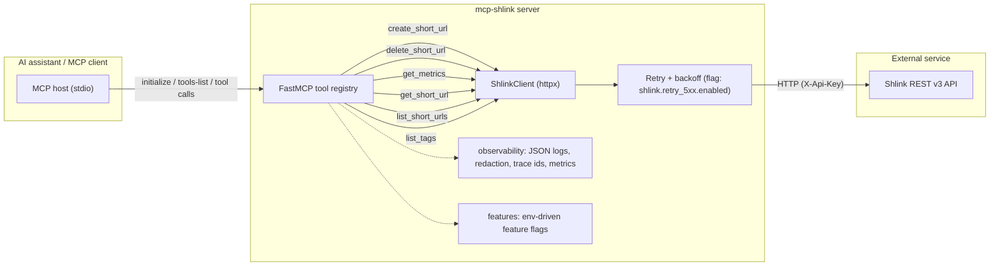

# Architecture & Service Dependencies

The diagram below is **generated** from the live MCP tool registry by
`scripts/generate_architecture_diagram.py` and verified in CI
(`generate_architecture_diagram.py --check`), so it cannot drift from the code.

## External service dependencies

| Dependency | Protocol | Auth | Failure handling |
|------------|----------|------|------------------|
| Shlink REST v3 | HTTPS (JSON) | `X-Api-Key` header | 5xx/connection errors retried with exponential backoff behind `shlink.retry_5xx.enabled`; 4xx surfaced as `httpx.HTTPStatusError` |

There are no databases, queues, or other external services. Configuration and
optional integrations are listed in the README (Configuration and Error
tracking sections).
